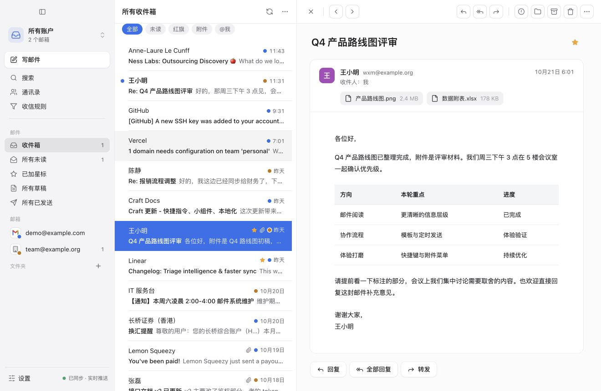
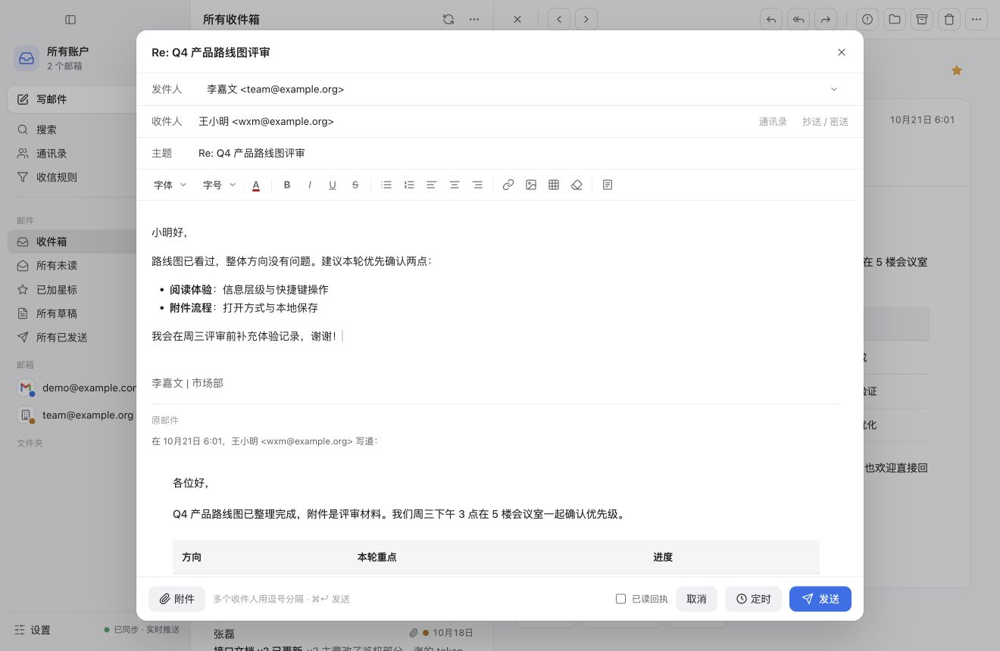
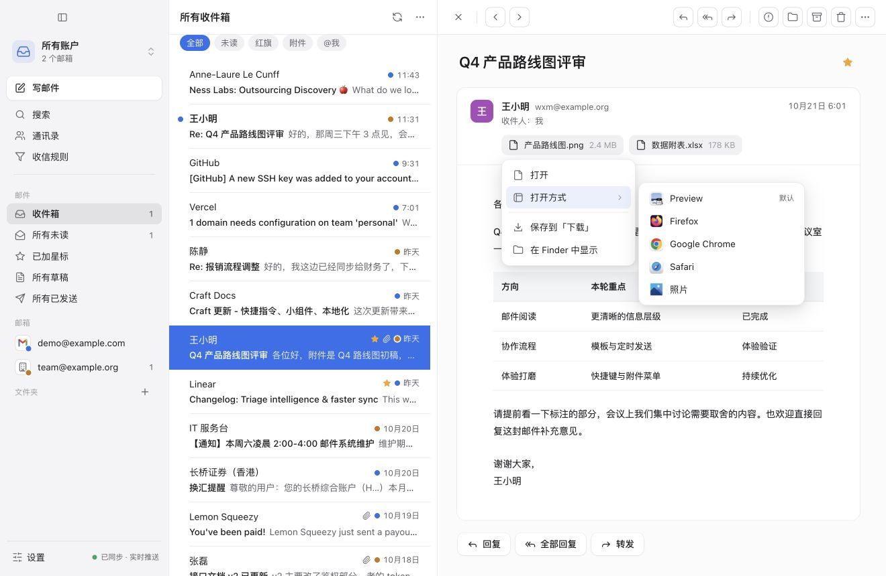
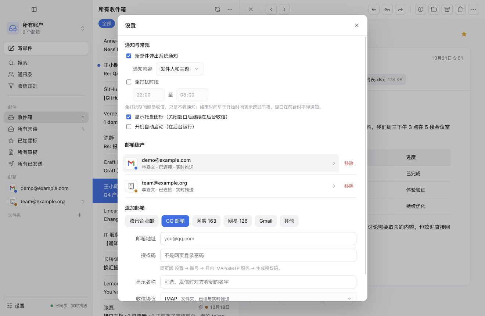
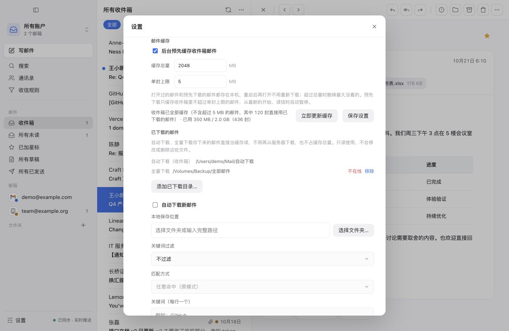
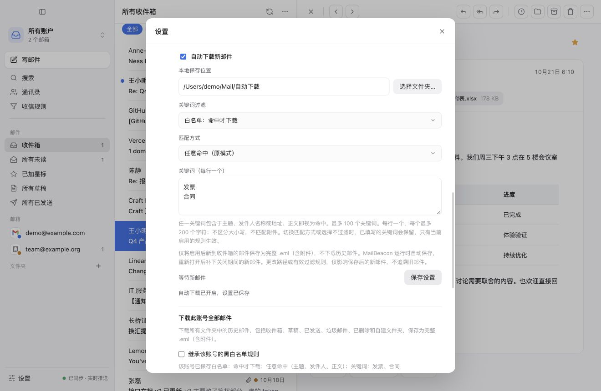
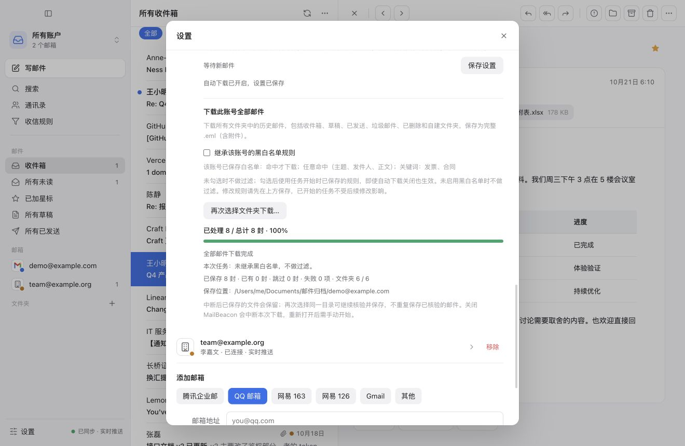

# MailBeacon

简洁的 macOS 邮件客户端，集成多邮箱收发、邮件整理与本地备份。

[下载最新版](https://github.com/lsclpangpang/mailbeacon/releases/latest) · [使用指南](docs/usage.md) · [开发文档](docs/development.md) · [更新记录](CHANGELOG.md)



以下截图均使用演示账号和模拟邮件。

<details>
<summary>写信与回复</summary>



</details>

<details>
<summary>附件与打开方式</summary>



</details>

<details>
<summary>邮箱与通知设置</summary>



</details>

<details>
<summary>邮件缓存与已有下载目录</summary>



</details>

<details>
<summary>自动下载与全量备份</summary>





</details>

## 功能

| 功能 | 支持内容 |
| --- | --- |
| 收信与阅读 | 多账号、统一收件箱、IMAP 实时推送、会话视图、范围搜索、IMAP 离线快照 |
| 写信 | 富文本、附件、独立签名、自动草稿、模板、定时发送、发送记录、已读回执 |
| 邮件整理 | 批量整理、删除确认、限时撤销、文件夹与收信规则 |
| 账户修复 | 原地更新连接参数与授权码，分别检测收发信 |
| 通讯录 | 联系人与分组、收件人联想、vCard / CSV 导入导出 |
| 邮件缓存 | 后台预缓存、容量与单封上限、已下载目录复用 |
| 自动下载 | 保存启用后新到收件箱的完整 `.eml`，包含附件 |
| 全量下载 | 按账号和文件夹备份历史邮件；可取消，再次开始时核验已有文件 |
| 下载过滤 | 黑白名单；主题、发送人、收件人、正文可分别设置关键词 |
| 通知与后台 | 按账号提醒、免打扰、托盘收信、开机启动 |

缓存、自动下载和全量下载目前仅支持 IMAP，在「设置 → 邮箱账户」中配置。详细操作见[使用指南](docs/usage.md)。

## 安装

1. 在 [Releases](https://github.com/lsclpangpang/mailbeacon/releases/latest) 下载 `MailBeacon_*_universal.dmg`，支持 Apple Silicon 和 Intel Mac。
2. 打开安装包，将 MailBeacon 拖入「应用程序」。
3. 添加邮箱时填写**授权码**，各邮箱服务的获取方式会在添加页面提示。

当前版本未经 Apple 开发者证书签名。首次打开若被拦截，可在「系统设置 → 隐私与安全性」中选择「仍要打开」，或执行：

```sh
xattr -dr com.apple.quarantine /Applications/MailBeacon.app
```

授权码加密保存在本机。旧版升级可能需要一次钥匙串授权以完成迁移；备份或换机请参照[账户数据说明](docs/usage.md#授权码迁移与备份)。

## 常用快捷键

`J` / `K` 上下封 · `R` 回复 · `E` 归档 · `S` 星标 · `⌘N` 写信 · `⌘F` 搜索 · `Esc` 关闭

`Space` 先滚动正文，到底后优先打开后续未读邮件；没有未读则打开下一封。

## 开发

```sh
npm ci
npx tauri dev
```

构建、测试、发布与本机签名见[开发文档](docs/development.md)。
